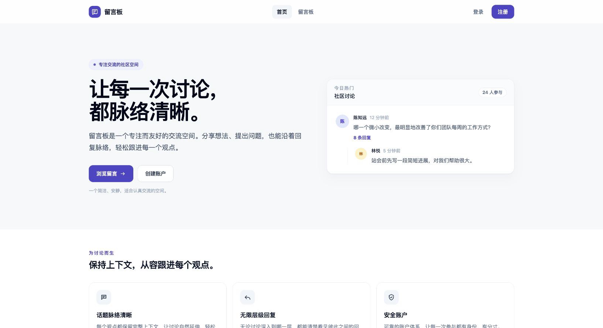
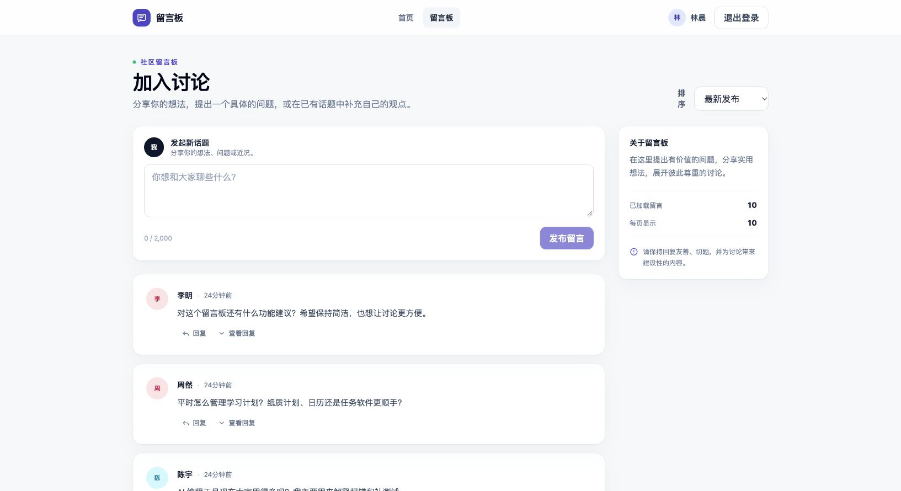
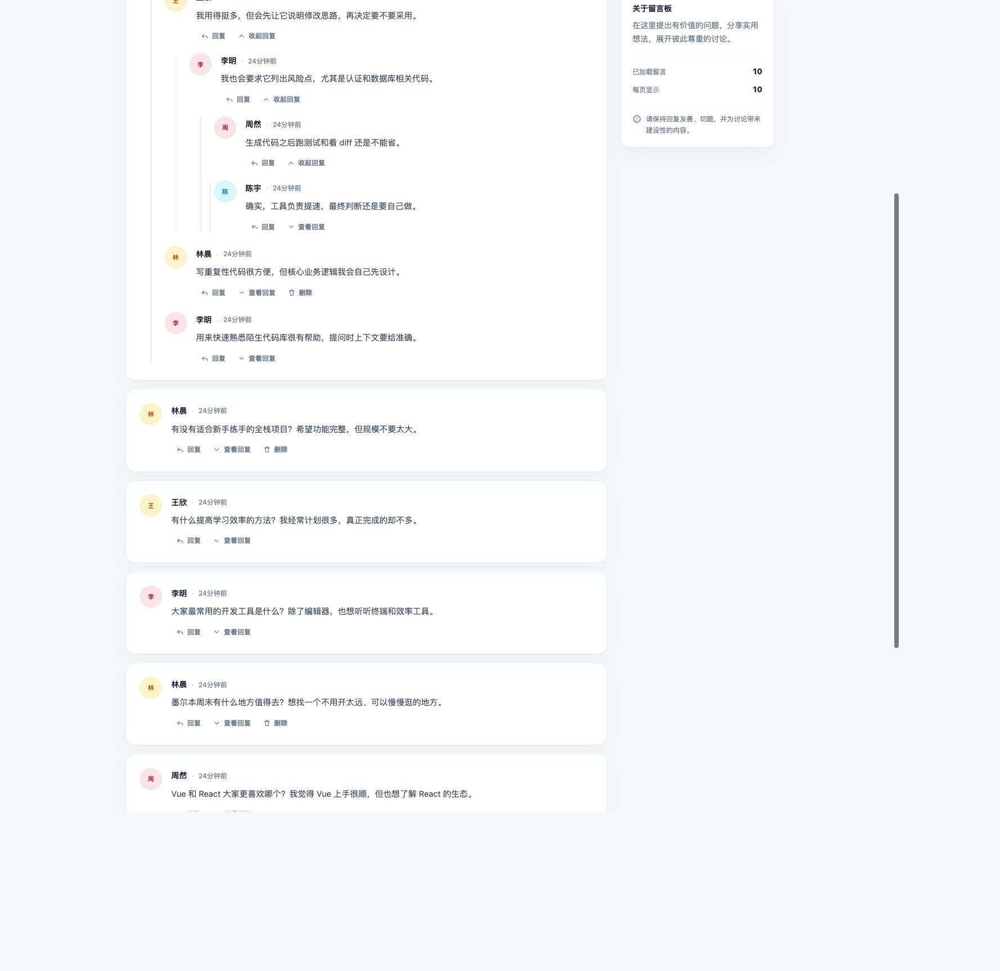
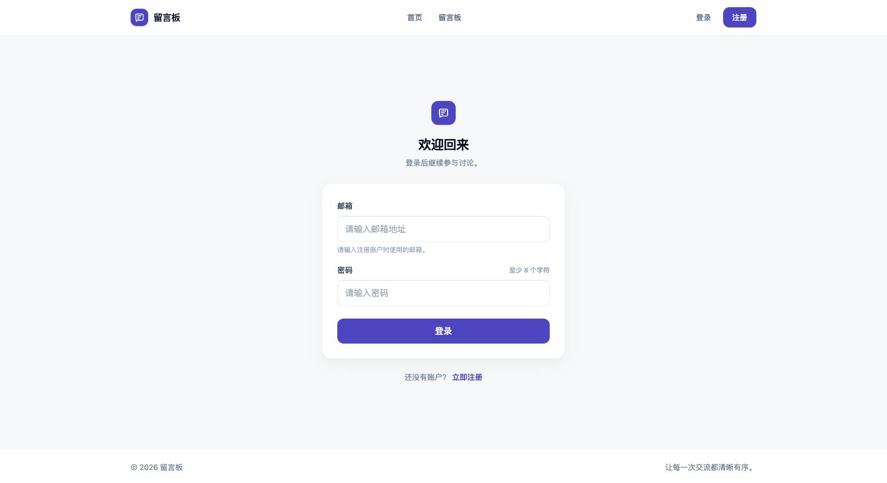
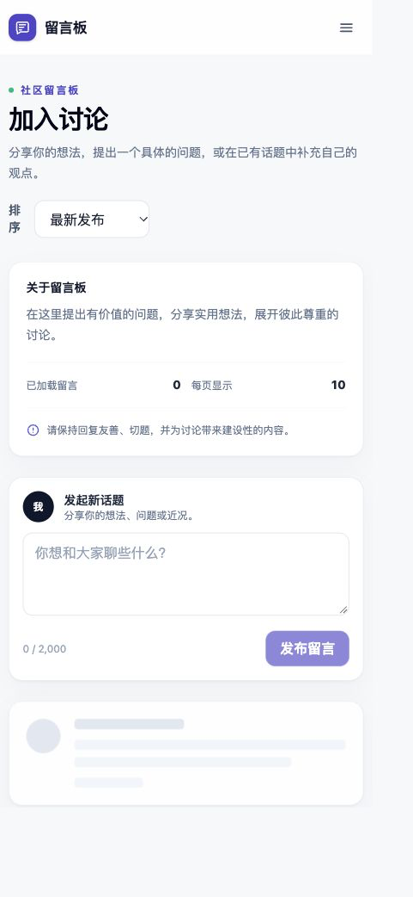

# 留言板 Message Board

这是我开发的一个基于 Vue 3 和 Firebase 的中文社区留言板。我希望它不只是完成注册、登录和发布留言这些基础功能，也能承载真实社区中常见的多层讨论，因此重点实现了无限层级回复、按需加载、游标分页和软删除机制。

这个项目展示了我对前端组件设计、Firestore 数据建模、访问控制、查询性能和生产部署的完整实践。

## 在线体验

- **Live Demo：** [https://message-board-8bi.pages.dev](https://message-board-8bi.pages.dev)
- **GitHub Repository：** [https://github.com/jiawei-wang-dev/message-board](https://github.com/jiawei-wang-dev/message-board)

## 项目截图

### 首页



### 留言板



### 多层回复



### 登录与移动端

<p>
  
  
</p>

## 项目概览

前端使用 **Vue 3、Vite、Vue Router 和 Tailwind CSS**，身份认证与数据存储分别由 **Firebase Authentication** 和 **Cloud Firestore** 提供，生产站点部署在 **Cloudflare Pages**。

我没有引入大型状态管理库、UI 框架或传统后端框架。当前规模下，Vue Composables 足以管理共享状态，而 Firebase Authentication、Firestore 客户端 SDK 与 Security Rules 已能完成业务所需的身份、数据和安全边界；这样既保持了代码清晰，也避免了不必要的复杂度。

## 核心功能

- **完整认证流程：** 支持邮箱注册、登录、退出、刷新后保持会话，以及未登录访问留言板时的路由保护。
- **留言浏览与发布：** 登录用户可以发布根留言，并按最新或最早时间排序。
- **无限层级回复：** 任意留言都可以继续回复，前端使用递归组件呈现讨论树。
- **按需加载：** 根留言使用游标分页；回复仅在展开分支时读取，每个回复分支也拥有独立分页。
- **安全软删除：** 作者只能删除自己的留言。删除后显示“该留言已删除”，已有子回复仍然保留。
- **完善的界面状态：** 包含加载骨架、空状态、Toast、删除确认对话框和友好的中文错误提示。
- **响应式与 Accessibility：** 深层回复会在窄屏减少缩进，并提供语义化结构、键盘操作、可见焦点和状态播报。
- **生产级安全与验证：** 使用 Firestore Security Rules、自动化测试和 Emulator 测试保护数据，前端由 Cloudflare Pages 持续部署。

## 我在这个项目中的主要设计

### 无限层级回复

所有根留言和回复都保存在同一个 `comments/{commentId}` 集合中，通过 `parentId` 和 `rootId` 表达关系，而不是创建无限嵌套的 Firestore 子集合。

```text
A（rootId: A, parentId: null）
├── B（rootId: A, parentId: A）
│   └── D（rootId: A, parentId: B）
└── C（rootId: A, parentId: A）
```

这种扁平数据结构使任意节点的直属回复都能用同一种查询方式读取。界面由 `CommentItem.vue` 递归渲染，因此讨论深度不受组件结构限制。

### Lazy Loading 与 Cursor Pagination

我没有在进入留言板时加载整棵讨论树：

- 根留言每页读取 10 条；
- 每个父留言的回复每页读取 5 条；
- Firestore 查询使用 `limit` 与文档快照 `startAfter` 继续下一页。

只有用户展开某个分支时，应用才查询该节点的直属回复。这样能控制 Firestore reads，避免活跃讨论不断增长后一次性传输大量无关数据，同时让“加载更多”保持稳定且可预测。

### 软删除

我选择软删除来保护讨论上下文，而不是直接移除节点：

```text
[该留言已删除]
└── 原有回复仍然存在
```

删除操作只会清空正文并记录删除状态，作者、父节点、根节点和创建时间保持不变。即使父留言被删除，下面的讨论仍然可以被理解和浏览。

### 安全边界

安全由 **Firebase Authentication + Firestore Security Rules** 共同保证，而不是只依赖前端按钮是否可见。Rules 会验证身份、字段白名单和父子关系，确保用户不能冒充其他作者、只能软删除自己的留言、不能恢复已删除节点，也不能执行物理删除；无效的 `parentId` / `rootId` 关系同样会被拒绝。

## 架构

```text
Browser
│
├─ Vue 3
│  ├─ Vue Router
│  ├─ Recursive CommentItem
│  ├─ Services / Composables
│  └─ Tailwind responsive UI
│
├─ Firebase Authentication
│
└─ Cloud Firestore
   ├─ users
   └─ comments

Hosting: GitHub → Cloudflare Pages
```

## Firestore 数据模型

`users/{uid}` 保存用户公开资料；`comments/{commentId}` 保存所有根留言和回复。核心留言结构如下：

```js
{
  userId: "作者 UID",
  userName: "显示名称",
  content: "留言内容",
  parentId: null,        // 根留言为 null；回复指向直属父留言
  rootId: "commentId",  // 整棵讨论树的根留言 ID
  createdAt: Timestamp,
  isDeleted: false
}
```

根留言的 `parentId` 为 `null`，`rootId` 等于自身文档 ID；回复的 `parentId` 指向直属父节点，`rootId` 始终继承根节点 ID。针对根留言排序和回复查询的复合索引记录在 `firestore.indexes.json` 中。

## 本地运行

建议使用 Node.js 20.19+（或 22.12+）和 npm 10+。

```bash
git clone https://github.com/jiawei-wang-dev/message-board.git
cd message-board
npm install
cp .env.example .env.local
```

在 Firebase Console 注册 Web App，并从“项目设置 → 您的应用”取得公开 Web 配置，然后填写 `.env.local`：

```dotenv
VITE_FIREBASE_API_KEY=
VITE_FIREBASE_AUTH_DOMAIN=
VITE_FIREBASE_PROJECT_ID=
VITE_FIREBASE_STORAGE_BUCKET=
VITE_FIREBASE_MESSAGING_SENDER_ID=
VITE_FIREBASE_APP_ID=
```

不要在这里放置服务账号私钥，也不要提交 `.env.local`。完成配置后启动开发服务器：

```bash
npm run dev
```

## 测试

项目包含 15 个单元测试，以及覆盖认证、作者身份、不可变字段、父子关系、软删除和物理删除限制的 Firestore Security Rules 测试。

```bash
npm run test        # Vitest 单元测试
npm run test:rules  # Firestore Rules 测试
npm run test:all    # 运行全部测试
```

Rules 测试使用独立 Firebase Emulator，不会读取或修改生产数据。

## 部署

前端通过 **GitHub → Cloudflare Pages** 部署：

```text
Build command: npm run build
Output directory: dist
Backend services: Firebase Authentication + Cloud Firestore
```

Cloudflare Pages 负责静态站点和 SPA 路由回退，Firebase 提供认证、数据库与 Security Rules。生产版本可在 [https://message-board-8bi.pages.dev](https://message-board-8bi.pages.dev) 访问。
